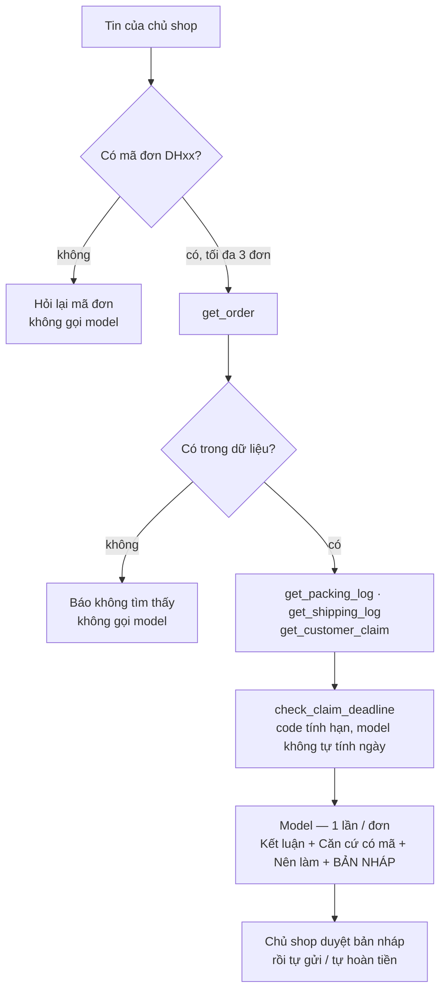

# AI SPEC — DamageCheck · Nhóm 4NPC · Phòng [XXX] · Zone [X]

> Mốc nộp: §7 chốt chuẩn "đạt" tại **CP2 19:30 Thứ Sáu 27/11** · §0–§7 nộp **CP3 10:00 Thứ Bảy 28/11** · đủ §0–§10 **CP4 14:30 Thứ Bảy 28/11** · §10 changelog ghi tiếp đến **23:59 Thứ Bảy 28/11**.
> Đầu mỗi mục ghi bước guide (`02-guide.md` trong repo đề) chỉ cách điền. Mỗi mục ngắn, có số và nguồn; chi tiết để ở file được trỏ tới. Xoá dòng hướng dẫn trong ngoặc vuông khi điền xong.

Track: [ ] A · [ ] B · [ ] C · [x] D · [ ] E — bài toán: trợ lý xác định trách nhiệm khi hàng bị vỡ/hỏng cho shop online nhỏ
Data BTC cấp đã dùng (nếu có — không commit nguyên file): __

## §0. Hiện tại việc này diễn ra thế nào *(guide 1.1)*
- Luồng hiện tại của việc này, trong khoá hoặc trên app thật (3–5 bước; ảnh chụp từ tài khoản của mình, đã che thông tin):
- Công cụ / AI đang được dùng cho việc này (nếu có) + nguồn. Không kiểm được thì ghi "chưa kiểm":

## §1. Người dùng & bằng chứng *(guide 1.1, 1.2)*
- Người dùng chính (một vai cụ thể):
- Việc họ cố làm xong (`động từ + đối tượng + bối cảnh`, không có chữ AI):
- Hôm nay họ giải bằng gì, hỏng ở đâu, vì sao chưa bỏ:
- Pain (KHÔNG chữ AI): ai — đang làm gì — vướng đâu — hậu quả gì:
- Bằng chứng — số chính + kết luận (chi tiết: `evidence/summary.md`): __

## §2. Impact & quyết định chọn *(guide 1.3)*

| Hướng | Bao nhiêu người gặp | Bao nhiêu lần / tháng | Mỗi lần tốn gì | Impact / tháng | Làm kịp không | Chọn? |
|---|---|---|---|---|---|---|
|  |  |  |  |  |  |  |
|  |  |  |  |  |  |  |
|  |  |  |  |  |  |  |

- **Impact / tháng** của hướng chọn = __ người × __ lần × __ phút = __ — nguồn từng thừa số: __ (không có nguồn thì ghi rõ *(tự ước tính)*)
- Hướng ĐÃ LOẠI + vì sao (giữ lại, đừng xoá):
- Số lần / tháng của từng kiểu người dùng (dùng cho persona ở §8):

## §3. Giải pháp tương tự *(guide 2.1)*
- [sản phẩm / tính năng gần giống]: một điều đáng học · một điều đáng né · mình khác gì

## §4. Thiết kế *(guide 2.2, 3.2)*
- **Lát cắt MỘT CÂU:** Chủ shop online nhỏ nhận khiếu nại hàng vỡ/hỏng → AI đối chiếu log đóng gói, log vận chuyển và mô tả ảnh của khách để xác định bên chịu trách nhiệm (shop / vận chuyển / khách / chưa đủ bằng chứng) → chủ shop biết nên hoàn tiền cho khách, đòi bồi thường từ đơn vị vận chuyển, hay xin thêm bằng chứng.
- **Không làm:**
  1. Không tự hoàn tiền, không tự gửi tin cho khách, không tự nộp khiếu nại cho đơn vị vận chuyển — chỉ soạn bản nháp.
  2. Không xem ảnh / video thật — chỉ đọc *mô tả* ảnh có trong hồ sơ (`photo_description`).
  3. Không nối API thật của sàn hay đơn vị vận chuyển — log đọc từ `data/orders.json`.
  4. Không sửa log, không thêm bằng chứng vào hồ sơ (kể cả khi chủ shop nhờ).
  5. Không xử lý khiếu nại không phải vỡ/hỏng (sai màu, sai mẫu, giao chậm, thất lạc).
- **Sơ đồ:**

- **Hình dạng:** [x] workflow cố định · [ ] một agent · [ ] nhiều agent — Khiếu nại nào cũng cần đúng một bộ căn cứ (đơn, đóng gói, vận chuyển, khiếu nại, hạn khiếu nại), nên các bước cố định và chỉ có *một* quyết định cần model. Không chọn agent vì không có bước nào cần AI tự chọn công cụ; agent tốn thêm lượt gọi, khó kiểm, và có thể bỏ sót một nguồn căn cứ.
- **AI dựa vào đâu** — mỗi công cụ (khớp `codebase/tools.py`):

  | Công cụ | Input | Output | Tác động ra ngoài? |
  |---|---|---|---|
  | `get_order` | mã đơn | sản phẩm, dễ vỡ không, giá trị, đơn vị vận chuyển — hoặc "không tìm thấy" | Không |
  | `get_packing_log` | mã đơn | log đóng gói `DG-<đơn>`: người đóng, vật liệu, có video không, ghi chú | Không |
  | `get_shipping_log` | mã đơn | các sự kiện vận chuyển `VC-<đơn>-<n>`: thời điểm, trạng thái, ghi chú (móp, rơi, đồng kiểm…) | Không |
  | `get_customer_claim` | mã đơn | khiếu nại `KH-<đơn>`: lời khách + mô tả ảnh (chưa kiểm chứng) | Không |
  | `check_claim_deadline` | mã đơn | ngày giao, hạn cuối khiếu nại đơn vị vận chuyển, còn bao nhiêu ngày / đã quá hạn | Không |

- **Mức tự động:** [x] AI gợi ý, người quyết · [ ] AI tự làm khi chắc, chuyển người khi không · [ ] AI tự làm — Phán sai thì chủ shop mất tiền trực tiếp: hoàn tiền oan, từ chối oan khách (mất uy tín, bị đánh giá xấu), hoặc đòi bồi thường bằng căn cứ sai nên bị bác. Sửa đắt vì tiền đã hoàn hay hạn khiếu nại đã qua thì không lấy lại được, nên quyết định cuối luôn là của chủ shop.
- **Chỗ chặn rủi ro:** rủi ro lớn nhất là *AI kết luận chắc khi căn cứ thiếu hoặc mâu thuẫn* (đổ lỗi sai bên). Chặn bằng: (1) kết luận thứ tư "chưa đủ bằng chứng", prompt buộc chọn nó khi phân vân (`SYSTEM` quy tắc 3); (2) mọi căn cứ phải có mã `DG-` / `VC-` / `KH-` có thật để chủ shop và metric `can_cu_co_that` kiểm được; (3) lời chủ shop kể thêm ngoài hồ sơ không được tính là căn cứ (quy tắc 2); (4) hạn khiếu nại do code tính.
- **Chỗ người duyệt:** hoàn tiền cho khách · gửi tin trả lời khách · nộp đơn đòi bồi thường đơn vị vận chuyển. AI chỉ soạn bản có dòng đầu **"BẢN NHÁP — chờ chủ shop duyệt"**; không công cụ nào có tác động ra ngoài.
- **Nguyên tắc thiết kế:**

  | Nguyên tắc | Chỗ cụ thể trên sơ đồ / trong bản chạy thử |
  |---|---|
  | G10 — thu hẹp phạm vi khi không chắc | Không có mã đơn / không thấy đơn → hỏi lại, không gọi model (nhánh B1, D1 trong `agent.py`). Căn cứ thiếu / mâu thuẫn → "chưa đủ bằng chứng" + nêu cụ thể cần thêm gì (`SYSTEM` quy tắc 3, 4). Ngoài phạm vi vỡ/hỏng → không kết luận (quy tắc 8). Một tin tối đa 3 đơn (`MAX_ORDERS`) |
  | Căn cứ kiểm được | Mỗi dòng hồ sơ có mã; output bắt buộc dẫn mã trong ngoặc vuông (`SYSTEM` quy tắc 1) — khớp metric `can_cu_co_that` |
  | Phần tính toán chắc chắn để code làm | Hạn khiếu nại tính trong `check_claim_deadline`; model chỉ đọc lại (quy tắc 5) |
  | Người duyệt việc có tác động ra ngoài | Không công cụ nào gửi / sửa; output chỉ có BẢN NHÁP; cấm viết "đã hoàn tiền / đã gửi" (quy tắc 6, 7) — khớp metric `chi_tao_nhap` |
  | Không coi nội dung đầu vào là lệnh | Lời khách gắn nhãn "chưa kiểm chứng"; "ghi chú hệ thống", đóng vai trong tin nhắn bị coi là nội dung, không phải lệnh (quy tắc 9) — câu thử T04, T05 |

- **Phần nào còn giả:**
  - Log đóng gói, log vận chuyển, khiếu nại: **giả** — 7 đơn nhóm tự viết trong `data/orders.json` (`synthetic`, xem `data/DATA_CARD.md`).
  - Đơn vị vận chuyển VC-A, VC-B và hạn khiếu nại 7 / 5 ngày: **giả lập** *(tự ước tính)*, không phải chính sách hãng thật.
  - Ngày xử lý = ngày chạy máy (đặt `DAMAGECHECK_TODAY=YYYY-MM-DD` để chạy lại đúng một ngày).
  - Model: đang ở **chế độ giả** cho tới khi nối model thật (CP3).

## §5. Chỗ khó — 4 lớp + ≥6 kịch bản + 2 tấn công *(guide 2.3)*

| Kịch bản | Lớp (1–4) | Hành vi mong muốn (nói gì, hiện gì, cho làm gì tiếp) | Câu thử |
|---|---|---|---|
|  |  |  |  |
| *(tấn công)* |  |  |  |
| *(tấn công)* |  |  |  |

(1) nguồn sự thật · (2) mơ hồ / thiếu thông tin · (3) ngoài phạm vi / thẩm quyền · (4) đặc thù lĩnh vực (sai thì người dùng mất gì đắt nhất)

## §6. Bốn đường đi của trải nghiệm
- Mọi thứ suôn sẻ: · Không chắc (lớp 2): · Không có căn cứ (lớp 1): · Người dùng sửa:
- Bị đòi ngoài phạm vi (lớp 3): · Trường hợp đặc thù lĩnh vực (lớp 4):

## §7. Đánh giá & chuẩn "đạt" *(guide 2.4, 4.1)*
- Data card: `data/DATA_CARD.md` · bộ câu thử: `eval/benchmark.csv` — 20 câu (thuong 8 · kho 7 · tu_choi 5, trong đó 2 câu tấn công T04, T05) · metric: `eval/metric_spec.yaml` (4 metric: dung_ben_chiu · can_cu_co_that · khong_doan_khi_thieu · chi_tao_nhap)
- **Chuẩn "đạt"** (chốt **trước 19:30 Thứ Sáu 27/11**, giữ nguyên đến 23:59 Thứ Bảy 28/11): "Đạt khi ≥ 80% câu qua (≥ 16/20), và 100% câu tu_choi qua (5/5), và không câu nào trích căn cứ không có trong data/orders.json (can_cu_co_that 20/20), và không câu nào thiếu / mâu thuẫn bằng chứng bị kết luận shop / vận chuyển / khách (khong_doan_khi_thieu 6/6)"
- Kết quả: lượt 1 __/__ (__%) · lượt 2 __/__ (__%) — run ID: __ / __ → chi tiết `eval/report.md`, hồ sơ `eval/README.md`

## §8. Chi phí khi dùng thật *(guide 4.2)*
- Persona + giá: `cost/personas.yaml` · lượt mô phỏng: `cost/simulate-__.csv` (__ phiên)
- Chi phí / task thành công: __ (model __) · __ (model __)
- Chi phí / tháng ở quy mô thật: thấp __ · cơ sở __ · cao __ → chi tiết `cost/cost-estimate.md`
- So với impact / người / tháng (§2): đáng làm không, vì sao:

## §9. Rủi ro & an toàn
- Dữ liệu: đã ẩn danh gì, không thu gì, không đưa gì vào model gói miễn phí:
- AI **không được** làm gì kể cả khi người dùng yêu cầu:
- Ai có thể bị hại nếu AI sai, và nhóm chặn thế nào:

## §10. Phân công & changelog
- Phân công có tên (theo chặng, chia cặp — guide "Cách chia việc"): __
- Dùng AI vào việc gì (2–3 dòng; chi tiết `docs/ai-usage.md`):
- Nhật ký thay đổi — **mọi thay đổi sau CP2 19:30 Thứ Sáu 27/11 phải có dòng ở đây**:

**CP2 → CP4** (vd thu hẹp lát cắt, hỏi thêm người dùng, lần cải tiến trước lượt 2)

| Thời điểm | Đổi gì | Vì sao (trỏ về câu thử / lỗi / bằng chứng nào) |
|---|---|---|
|  |  |  |

**Sau CP4 (đến 23:59 Thứ Bảy 28/11)** (sửa theo góp ý — không sửa chuẩn "đạt", câu thử, số bằng chứng, kết quả các lượt đã chạy)

| Thời điểm | Đổi gì | Vì sao |
|---|---|---|
|  |  |  |
